<div align="center">

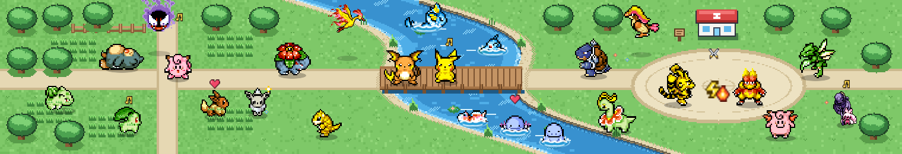

# Herdr Pokémon Party

**A GBA / NDS Pixel-Art Pokémon Living Ecosystem, Battle System & Theme Suite for [Herdr](https://herdr.dev)**

[](https://herdr.dev)
[](#lightweight-by-design)
[](#1-pokémon-battle-system)
[](README_zh.md)

<p>
  <b>English</b> &nbsp;|&nbsp; <a href="README_zh.md">简体中文</a> &nbsp;|&nbsp; <a href="README_ja.md">日本語</a> &nbsp;|&nbsp; <a href="README_ko.md">한국어</a>
</p>

</div>

---

## Core Systems

### 1. Pokémon Battle System

<div align="center">
  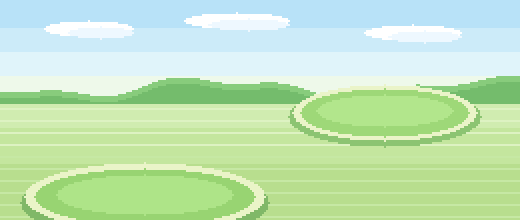
</div>

- **Drag-to-Battle**: Hold and drag any Pokémon onto another to trigger a KOF-style VS cut-in and launch an inline **GBA 3/4 diagonal battle** right inside the habitat panel — without blocking your terminal.
- **Authentic GBA Perspective & Controls**: Player back sprite vs. opponent front sprite (Gen 5 animated pixel art), classic parchment HP plates, `2×2` move grid, and full **keyboard (`↑↓←→` / `WASD` / `1–4` / `Enter` / `ESC`) & mouse** support.
- **Fixed 4-Move Sets**: Each Pokémon rolls 4 species-appropriate moves (including iconic signature moves) when generated and keeps them until you switch partners.
- **Real Token-Scaled Power**: On battle start, reads real session token usage on demand from **Claude Code (`cc`), Codex, Pi, and Antigravity (`agy`)** to compute a `×1.00–×2.25` damage multiplier (~25 ms on demand, zero background polling).
- **Pixel-Art Move Animations**: 13 bespoke animated GBA pixel-art FX GIFs with stage dimming, hit-flicker, and screen shake:

<div align="center">
  
  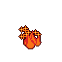
  
  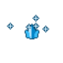
  
  
  
  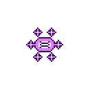
  
</div>

---

### 2. Living 2D Ecosystem

- **7 Hand-Crafted 2D Pixel Biomes** (with foreground canopy/bridge/reed depth occlusion & automatic rotation):

| Biome | Preview | Highlights |
| :--- | :---: | :--- |
| **Pallet River** | 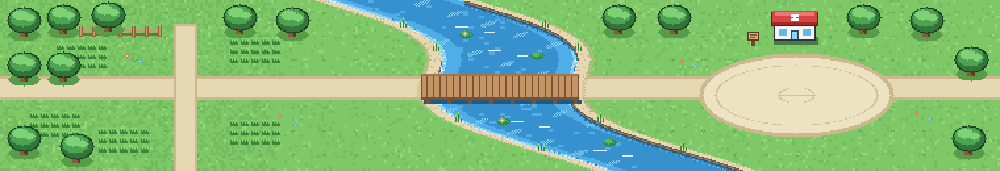 | Winding valley river, wooden bridge & wildflower plaza |
| **Cerulean Bay** |  | Archipelago bay, boardwalk pier & sandy islets |
| **Ecruteak Shrine** | 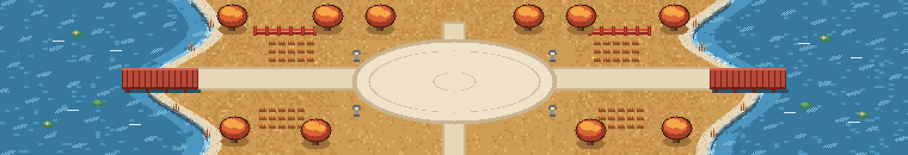 | Autumn maple woods, twin koi ponds & shrine bridges |
| **Mt. Moon Caldera** | 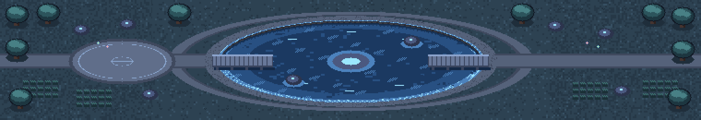 | Starlit crater lake, glowing moonstone & crystals |
| **Cinnabar Atoll** | 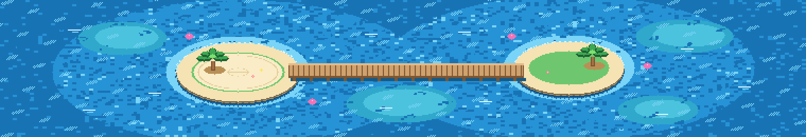 | Tropical coral atolls connected by an ocean bridge |
| **Sandstone Oasis** | 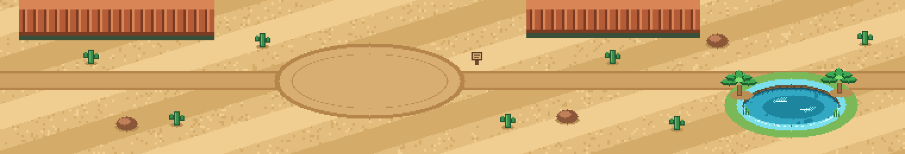 | Desert dunes, palm trees & emerald oasis spring |
| **Chimney Waterfall** | 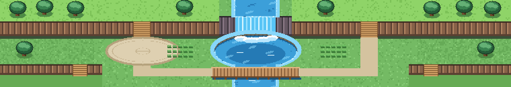 | Animated waterfall cascade, mist & canyon terraces |

- **Species-Aware Terrain AI**: Water Pokémon submerge and bob in lakes/rivers with ripples; flyers soar over canopies and perch on land; ground/rock Pokémon burrow underground; land Pokémon route across bridges and shores.
- **Autonomous Social Life & Draggable Interaction**: Pick up and drag any Pokémon anywhere; Pokémon spontaneously spar, play tag, race, hang out, celebrate completed tasks, and lead **`0.65×` subagent mini-followers**.
- **Workspace-First & One-Click Hide**: Full-bleed terminal workspace on top with a clean rounded habitat card below; recall the habitat into the bottom-right **Master Ball** anytime for 100% full-screen focus and release it back with one click.

---

### 3. Weather & Day/Night System

- **8 Native GPU Weather Effects**: Sunny motes, Breeze leaves, Blossom petals, Drizzle, Sunshower Rainbow, Fireflies, Shower, and Snow.
- **Dynamic Time of Day**: Automatic Day / Dusk / Night ambient lighting (or manually pinned in Habitat Settings).
- **Configurable Auto-Rotation**: Customize map & weather rotation intervals from the corner settings popup.

---

### 4. Unique Generation, Shiny Odds & Growth System

- **Three Unique Traits Rolled on Generation**: Every time a new Pokémon is generated (new agent or switching species), it independently rolls its own identity:
  - **Rare Shiny Odds (`1/64`)**: Purely random ~1.56% chance (no manual cheat switch) to sparkle as a rare **Shiny ✨** with a celebration toast, preserved through evolution.
  - **Random Individual Size (`XS / S / M / L / XL`)**: Each Pokémon rolls a unique body scale so even two Pikachus stand noticeably different in size.
  - **Random Fixed 4-Move Loadout**: Automatically rolls 4 moves from its elemental move pool (including signature moves) and locks them in for battle until you switch species.
- **Work-XP Leveling & Evolution**: Active coding earns Work-XP to level up (`LV`) and evolve automatically; toggle **Lock Evo** (Everstone) anytime to keep a favorite form.
- **Clean Nameplates & Gen 1–9 Pokédex**: Only the project name sits underfoot while hovering reveals a split `[ LV | Name ]` RPG plate; search all Gen 1–9 Pokémon by name or `#number` with on-demand icon caching.

---

### 5. Audio, Poké Ball Spaces & 4-Language UI

<div align="center">
  
  
  
  
  
  
  
  
  
  
</div>

- **Dual Softened Cry Engines**: Switch between `Let's Go` and `Showdown` cries, gently audio-filtered via `ffmpeg` for non-intrusive `blocked` / `done` cues.
- **10 Pixel-Art Poké Ball Spaces**: Right-click any sidebar space to assign its signature Poké Ball.
- **4-Language In-App UI (`English` / `简体中文` / `日本語` / `한국어`)**: Switch interface language anytime from Habitat Settings, with localized Pokédex & battle move names.
- **Full Theme Suite**: Daylight & Mt. Moon Night themes, GBA pixel-font / clean soft mode toggle in Habitat Settings, custom file icons, dialogs, menus, and toasts.

---

## Lightweight by Design

- **~1.5 MB total repository** — all 7 biomes, 15 animated pixel FX GIFs, 10 Poké Balls, and full UI assets included.
- **Strictly on-demand caching** — sprites, portraits, icons, and cries are downloaded only for currently active agents.
- **Zero idle bloat** — hiding the habitat drops render overhead to zero; overworld roaming pauses during battles; token reading runs on demand only.

---

## Quick Start

### Prerequisites
- [Herdr](https://herdr.dev)
- Recommended for 4-direction sprite slicing & soft cry audio:
  ```bash
  brew install imagemagick ffmpeg
  ```

### Install & Activate

```bash
git clone https://github.com/anson-no-bug/herdr-pokemon-party.git
cd herdr-pokemon-party
chmod +x install.sh
./install.sh

herdr-app check ~/.config/herdr-app/mods/herdr-pokemon
herdr-app do layout.switch '{"name":"herdr-pokemon"}'
herdr-app do app.theme '{"name":"herdr-pokemon-night"}' # or "herdr-pokemon" for light mode
```

### Controls

| Action | Description |
| :--- | :--- |
| **Right-click Pokémon / Sidebar Party** | Open Gen 1–9 Pokédex Picker, toggle Lock Evo, or switch Cry engine |
| **Hold & Drag Pokémon → Drop on Another** | Launch inline GBA Pokémon Battle |
| **Battle: `↑↓←→` / `WASD` / `1–4` / `Enter` / `ESC`** | Full keyboard move selection, attack, and exit |
| **Habitat `×` / Bottom-Right Master Ball** | Recall & hide Habitat / Release & reopen Habitat |
| **Habitat Settings (Gear Icon)** | Switch Language (`EN`/`中文`/`日本語`/`한국어`), UI Style, Biome, Weather & Day/Night |
| **Right-click Sidebar Space** | Choose from 10 pixel-art Poké Balls |

---

## Credits & Acknowledgements

This project builds on and pays tribute to these wonderful open-source projects and community art archives:

- **[Herdr](https://herdr.dev)** — The multi-agent terminal workspace and its extensible GPUI mod/layout system, along with inspiration from early community Pokémon mods (`pokemon-agents` / `pokemon-herd`).
- **[PMDCollab / SpriteCollab](https://github.com/PMDCollab/SpriteCollab)** — Expressive Pokémon Mystery Dungeon 4-direction animated overworld sprites and portraits (fetched on demand).
- **[PokeAPI / Sprites](https://github.com/PokeAPI/sprites)** & **[PokeAPI / Cries](https://github.com/PokeAPI/cries)** — Gen 5 animated front/back battle sprites, menu icons, and Pokémon cries.
- **[Pokémon Showdown](https://play.pokemonshowdown.com)** — Classic Pokémon battle cry audio.

> **Disclaimer**: Non-commercial fan-made open-source project. Pokémon and all related names, sprites, and audio are trademarks/copyrights of Nintendo / Creatures Inc. / GAME FREAK inc.
