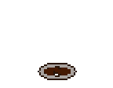
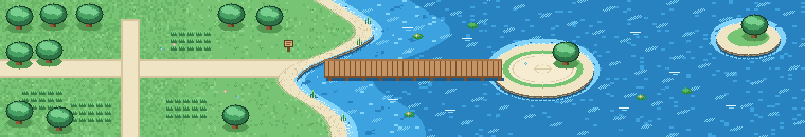
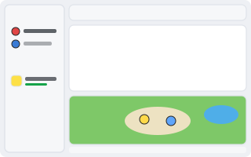

<div align="center">


# Herdr Pokémon Party (`herdr-pokemon-party`)

**为 [Herdr](https://herdr.dev) 打造的经典 GBA / NDS 像素风宝可梦生态园 & 互动对战主题套装**

*An authentic GBA/NDS pixel-art Pokémon living ecosystem, real token-scaled battle minigame & workspace-first theme suite for [Herdr](https://herdr.dev).*

[](https://herdr.dev)
[](#轻量化与性能承诺)
[](#双语与全界面覆盖)
[](#核心亮点功能)

<br/>


</div>

---

## 为什么做这个项目？

在使用 **Herdr** 同时编排多个 AI 编程智能体（Claude Code / Codex / Pi / Antigravity）时，希望工作空间既有**专注高效的编码主屏**，又有一块**不喧宾夺主、充满生命力的像素宝可梦伴侣生态园**：
- 写代码时，每个智能体都是你队伍里的一只宝可梦，随工作状态巡逻、游泳、飞翔、打盹、积累经验自动进化；
- 想放松一下？直接**按住拖动**一只宝可梦放到另一只身上，瞬间触发 **GBA 经典 3/4 斜向对战**，消耗的真实 Token 还会转化成战力加成；
- 想 100% 全屏专注写代码？点击右上角 GBA 像素 `×`，把宝可梦和整张生态园**收入右下角大师球**，工作区立刻满屏，随时一键重新放出！

---

## 核心亮点功能

### 1. 拖拽开战 · 还原经典 GBA 实机宝可梦对战

<div align="center">
  
  <br/>
  
</div>

- **零地图侵入触发**：长按任意宝可梦拎起（附带专属挣扎动画），拖到另一只宝可梦上方时弹出街机 KOF 风格 **VS 锁定徽章**，松手即在生态园内部原位展开对战，不弹窗遮挡上方终端。
- **地道 GBA 对战视角与交互**：
  - 还原经典左下角**我方背影** × 右上方斜前方**对手正面**的 Gen 5 动态像素精灵视角。
  - 还原 GBA 奶白羊皮纸血条铭牌、暗青色对话栏与 `2×2` 招式选择面板。
  - **支持纯键盘 & 鼠标双操作**：方向键 / `WASD` 选招、`Enter` / `Space` 或数字键 `1–4` 直接出招、`ESC` 一键退出返回生态园。
- **固定专属 4 招**：每只宝可梦生成时固定随机抽取 4 个贴合属性的招式（含皮卡丘十万伏特、喷火龙爆炸烈焰、超梦精神击破等招牌技），仅在更换搭档时重新生成。
- **真实 Token 战力加成**：开战时按需读取 **Claude Code (`cc`) / Codex / Pi / Antigravity (`agy`)** 当前会话真实 Token 消耗，动态换算 `×1.00 ～ ×2.25` 伤害倍率（仅开战瞬间按需读取尾部字节，耗时 ~25ms，平时零后台 IO）。
- **13 套招式维度 GBA 像素逐帧动画特效**（附带大招舞台压暗、受击 3 次经典闪烁与震屏）：

| 落雷 / 十万伏特 | 喷射火焰 / 大字爆炎 | 水炮 / 冲浪 | 急冻光线（冰封碎裂） | 飞叶风暴 / 飞叶快刀 |
| :---: | :---: | :---: | :---: | :---: |
|  |  |  |  |  |

| 叶刃 / 近身战斩击 | 地震 / 终极冲击 | 精神强念 / 暗影球 | 破坏光线 / 日光束 | 回复 / 剑舞 / 守住 |
| :---: | :---: | :---: | :---: | :---: |
|  |  |  |  |  |

---

### 2. 稀有闪光随机遭遇（1/64）· 成长进化 · 个体差异

- **真正的概率出闪（拒绝手动开关作弊）**：每次新建智能体或切换新宝可梦时，以 **`1/64`（≈ 1.56%）** 概率自然判定是否为稀有**闪光（Shiny ✨）**个体；命中闪光时触发专属惊喜通知与金色星芒闪耀，进化后仍保留闪光身份！
- **工作经验升级与自动进化**：智能体持续编码工作会积累经验提升等级（`LV`），到达进化阶段后自动无缝进化；图鉴中提供「**锁定进化**（不变之石）」开关，想一直留着皮卡丘或伊布也能自由锁定。
- **个体体型差异**：每只宝可梦拥有独立的 `XS / S / M / L / XL` 体型缩放。
- **清爽悬浮铭牌**：生态园脚下仅展示简洁的项目/标签名；鼠标悬停在宝可梦身上时，头顶弹出精致的两段式 RPG 铭牌 `[ LV xx | 宝可梦名称 ]`。

---

### 3. 七大 2D 生态地貌 × 动态天气 × 真实物种地形 AI

内置 **7 张自绘 2x 像素俯视大地图 + 前景树冠/桥栏/芦苇遮挡层 + 立体水岸**，支持定时自动轮换或点击左上角图标随时切换：

| 生态地图 | 场景预览 | 特色地形 |
| :--- | :---: | :--- |
| **真新镇曲流原野** (`Pallet River`) |  | 曲流草地、木桥、河畔野花与树荫 |
| **华蓝群岛海湾** (`Cerulean Bay`) |  | 碧蓝海湾、连岛木栈道、沙滩浅岸 |
| **缘朱双池神社** (`Ecruteak Shrine`) |  | 红叶秋林、朱红神社长桥与锦鲤双池 |
| **月见山环形湖** (`Mt. Moon Caldera`) |  | 星夜火山口、月之石环湖与水晶丛 |
| **红莲珊瑚深海** (`Cinnabar Atoll`) |  | 热带珊瑚环礁、双岛跨海木桥 |
| **沙砾荒漠绿洲** (`Sandstone Oasis`) |  | 金黄沙丘、棕榈树影与沙漠绿洲池 |
| **烟囱山瀑布峡谷** (`Chimney Waterfall`) |  | 动态倾泻瀑布、飞溅水雾与峡谷岩台 |

- **真实物种生态行为**：
  - **水系/游泳宝可梦**：入水瞬间半身没入水面、激起水花涟漪并随波起伏，不再「干脚踩水」。
  - **飞行/漂浮宝可梦**：在空中展翅掠过树冠与水面，空闲时降落陆地收翅栖息，绝不落在水面上。
  - **地面/岩石系宝可梦**：可钻入泥土半身潜行、再欢快破土跃出。
  - **陆地宝可梦**：严格遵守地形，会自动绕行木桥与岸边，绝不横穿湖海。
- **8 种原生 GPU 动态天气 + 昼夜光影**：晴朗微尘、微风落叶、花瓣飘落、细雨、雨后彩虹、萤火虫、阵雨、飘雪，外加白天 / 黄昏 / 夜晚自动切换。

---

### 4. 可自由拖拽 · 宝可梦自主社交互动 · 子代理跟班

- **随手拎起互动**：按住任意宝可梦即可拎起悬空（触发挣扎小动画），放到水里会扑通溅起水花（旱鸭子落水会慌张游回岸边），放到另一只宝可梦身上即开启正式对战。
- **生态园自主日常互动**：
  - **随地切磋**：宝可梦之间会自发随机切磋、发招、闪避、弹出迷你血条与伤害字；
  - **追逐嬉戏 / 竞速赛跑 / 广场聚会 / 独自伸懒腰练招**；
  - **任务完成庆祝**：当某个智能体完成任务（`done`）时，附近伙伴会围过来欢呼跳跃；
  - **子代理（Subagent）跟班**：智能体派生的子代理会自动以 `0.65×` 迷你初始形态宝可梦跟在主宝可梦身后排队列同行！

---

### 5. 工作区优先布局 · 大师球一键收入与放出

<div align="center">
  <table>
    <tr>
      <td align="center"><br/><sub>右上角像素关闭键</sub></td>
      <td align="center"><br/><sub>逐只收入大师球</sub></td>
      <td align="center"><br/><sub>右下角常驻大师球</sub></td>
      <td align="center"><br/><sub>一键放出整片生态</sub></td>
    </tr>
  </table>
</div>

- **主次分明**：上方终端工作区全屏铺满（零多余留白）；下方生态园收在黄金展示高度（`220px`）的精致圆角卡片内，四角无缝圆角遮罩。
- **一键隐藏 / 展开**：点击生态园右上角像素 `×`（或右下角大师球），每只宝可梦与整张地图画布会依次缩放吸入右下角大师球中，生态园完全收起至 `0px`，工作区瞬间 100% 全屏；点击常驻右下角的像素大师球，生态园与宝可梦即伴随星芒动画逐只跳出归位！

---

### 6. 双音效引擎 · 10 种精灵球空间 · 双语全界面覆盖

<div align="center">
  
  
  
  
  
  
  
  
  
  
</div>

- **双原声叫声引擎**：支持 `Let's Go` 与 `Showdown` 两套宝可梦叫声，经 `ffmpeg` 柔和降噪滤波处理，智能体等待处理（`blocked`）或完成任务（`done`）时以温柔叫声/轻鸣提醒，不刺耳。
- **10 种像素精灵球空间**：每个 Herdr Space 可右键自由更换精灵球外观（精灵球、超级球、高级球、大师球、纪念球、治愈球、潜水球、黑暗球、豪华球、巢穴球）。
- **纯中文 / 纯英文全局切换**：在生态园设置中一键切换全局语言，完整收录 260 只宝可梦官方中文译名与招式译名，拒绝中英混杂。
- **日间 / 月见山暗夜双主题 & 视觉模式切换**：支持精致清爽模式与经典 GBA 像素字体模式（`Alt+Shift+G` 一键切换），全套覆盖侧边栏、标签页、文件树、Git Diff、弹窗、右键菜单与通知横幅。

<div align="center">
  
</div>

---

## 轻量化与性能承诺

- **仓库极简**：全仓（含 7 张 2D 生态图、15 套像素动画 GIF、10 种精灵球、全套 UI 图标与代码）总大小仅 **~1.5 MB**。
- **严格按需缓存**：宝可梦精灵、立绘、图鉴图标与叫声均仅对当前活跃智能体按需下载并缓存至本地磁盘，不预下载整库。
- **零后台浪费**：生态园收起至大师球后完全不占用渲染开销；进入对战时自动暂停大地图巡逻；Token 统计仅在开战瞬间按需读取。

---

## 快速安装

### 环境依赖
- 已安装 [Herdr](https://herdr.dev)
- 建议安装 `ImageMagick`（用于切割 4 向动态像素精灵）与 `ffmpeg`（用于叫声柔和滤波）：
  ```bash
  brew install imagemagick ffmpeg
  ```

### 一键安装并启用

```bash
git clone https://github.com/anson-no-bug/herdr-pokemon-party.git
cd herdr-pokemon-party
chmod +x install.sh
./install.sh

# 校验安装完整性
herdr-app check ~/.config/herdr-app/mods/herdr-pokemon

# 在 Herdr 中切换到本主题布局
herdr-app do layout.switch '{"name":"herdr-pokemon"}'
```

### 常用快捷键与交互

| 操作 | 功能 |
| :--- | :--- |
| **右键点击宝可梦 / 侧边栏队员** | 打开 Gen 1–9 宝可梦图鉴更换搭档、设置「锁定进化」或切换叫声音效 |
| **长按拖动宝可梦 → 放到另一只身上** | 触发 KOF VS 过场，原地开启 GBA 宝可梦对战 |
| **对战中 `↑↓←→` / `WASD` + `Enter` / `1-4` / `ESC`** | 全键盘选招、出招、退出对战 |
| **点击生态园右上角像素 `×` / 右下角大师球** | 触发大师球吸入/放出动画，一键隐藏或展开生态园 |
| **`Alt + Shift + P`** | 快速为当前聚焦智能体打开宝可梦图鉴 |
| **`Alt + Shift + G`** | 一键切换清爽模式 / 经典 GBA 像素风格 |
| **右键侧边栏空间** | 更换该空间专属的 10 种像素精灵球 |

---

## 致敬与资源鸣谢 (Credits & Acknowledgements)

本项目的实现离不开以下优秀开源项目与社区艺术资源的启发与支持，在此致以诚挚敬意：

- **[Herdr](https://herdr.dev)** — 强大的多智能体终端工作台及其开放的 Mod / Layout / GPUI 生态体系，以及社区早期宝可梦插件（`pokemon-agents` / `pokemon-herd`）带来的灵感启发。
- **[PMDCollab / SpriteCollab](https://github.com/PMDCollab/SpriteCollab)** — 提供精美的《宝可梦不可思议迷宫》四方向动态像素精灵与多表情头像立绘（按需动态拉取）。
- **[PokeAPI / Sprites](https://github.com/PokeAPI/sprites)** & **[PokeAPI / Cries](https://github.com/PokeAPI/cries)** — 提供第五世代（黑/白）正反面动态对战精灵、图鉴菜单图标及最新宝可梦叫声资源。
- **[Pokémon Showdown](https://play.pokemonshowdown.com)** — 提供经典宝可梦对战叫声音效资源。

> **免责声明**：本项目为非商业开源爱好者作品。Pokémon（宝可梦）及相关角色名称、图像与音效版权均归 Nintendo / Creatures Inc. / GAME FREAK inc. 所有。
