<div align="center">

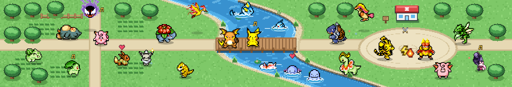

# Herdr Pokémon Party

**[Herdr](https://herdr.dev) 向け GBA / NDS ドット絵ポケモン生態園・バトルシステム＆テーマパック**

[](https://herdr.dev)
[](#軽量設計とパフォーマンス)
[](#1-ポケモンバトルシステム)
[](README.md)

<p>
  <a href="README.md">English</a> &nbsp;|&nbsp; <a href="README_zh.md">简体中文</a> &nbsp;|&nbsp; <b>日本語</b> &nbsp;|&nbsp; <a href="README_ko.md">한국어</a>
</p>

</div>

---

## コアシステム

### 1. ポケモンバトルシステム

<div align="center">
  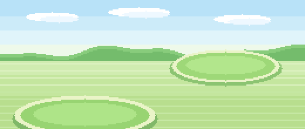
</div>

- **ドラッグで即バトル**：生態園のポケモンを長押しして別のポケモンに重ねると、アーケード風 VS カットインとともに**クラシックな GBA 斜め見下ろしバトル**が生態園内でシームレスに開始されます（上のターミナル作業を妨げません）。
- **本格的な GBA 視点＆操作性**：第5世代の正面・背面ドットアニメ、クラシックな HP プレート、`2×2` 技選択パネルを採用。**キーボード（`↑↓←→` / `WASD` / `1–4` / `Enter` / `ESC`）＆マウス**両対応。
- **固有の固定 4 技**：生成時にタイプに合った 4 つの技（専用技を含む）がランダム固定され、パートナーを変更するまで保持されます。
- **実トークン消費連動パワー**：バトル開始時に **Claude Code (`cc`) / Codex / Pi / Antigravity (`agy`)** の実セッション消費トークンをオンデマンド取得し、`×1.00〜×2.25` のダメージ倍率に反映（取得 ~25ms、常時バックグラウンド負荷ゼロ）。
- **技別ドット絵アニメーション**：13 種類の描き下ろし GBA ドット絵技エフェクト GIF（暗転・被弾点滅・画面揺れ演出付き）：

<div align="center">
  
  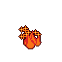
  
  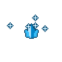
  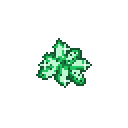
  
  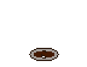
  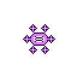
  
</div>

---

### 2. 生き生きとした 2D 生態園

- **7 種類のオリジナル 2D ドット絵マップ**（樹冠・橋の手すり・水辺の前景レイヤー付き、自動ローテーション対応）：

| マップ | プレビュー | 地形の特徴 |
| :--- | :---: | :--- |
| **マサラ川原 (Pallet River)** | 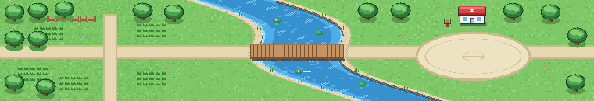 | 蛇行する川、木橋、花咲く広場 |
| **ハナダ湾 (Cerulean Bay)** | 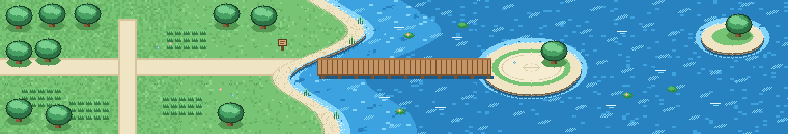 | 群島の入江、長い桟橋、砂浜の小島 |
| **エンジュ神社 (Ecruteak Shrine)** | 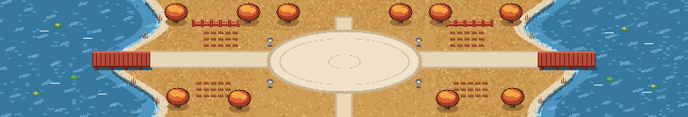 | 紅葉の森、双子の鯉池、朱色の橋 |
| **おつきみやま湖 (Mt. Moon Caldera)** | 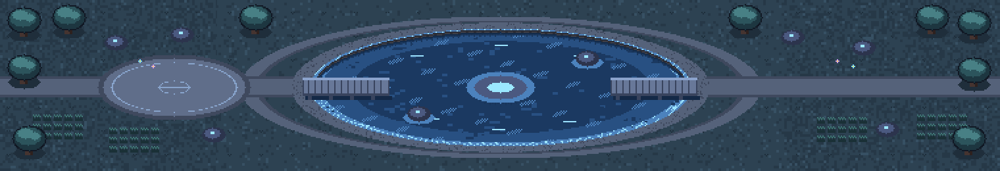 | 星空のカルデラ湖、月の石と水晶 |
| **グレン環礁 (Cinnabar Atoll)** | 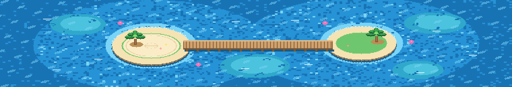 | 南国のサンゴ環礁と海を渡る木橋 |
| **砂漠のオアシス (Sandstone Oasis)** | 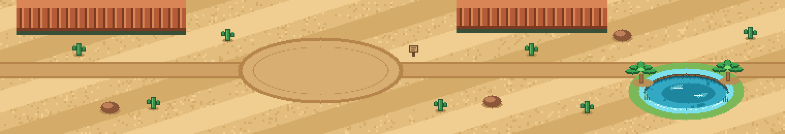 | 黄金の砂丘、ヤシの木陰と泉 |
| **えんとつ山渓谷 (Chimney Waterfall)** | 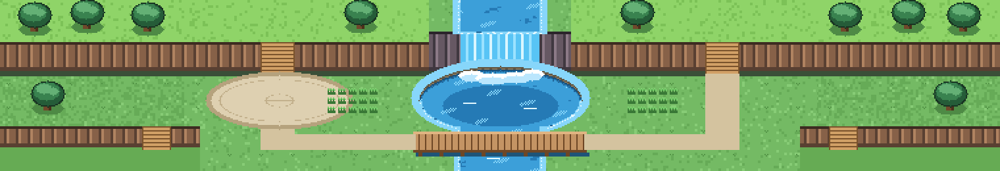 | 流れ落ちる滝、水しぶきと渓谷の段丘 |

- **種族に応じた地形 AI**：みずタイプは水中で半身を沈めて波紋を立てて泳ぎ、ひこうタイプは樹冠の上を飛んで陸地で羽を休め、じめん／いわタイプは地中に潜行、陸上ポケモンは橋を渡って移動します。
- **自律的な交流＆ドラッグ操作**：ポケモンをつまんで好きな場所へ移動可能。ポケモン同士で勝手にスパーリング・追いかけっこ・かけっこ・おしゃべり・タスク完了のお祝いを行い、**サブエージェントが `0.65×` のミニ連れ歩き**として後ろをついてきます。
- **作業優先レイアウト＆ワンクリック収納**：上部ターミナルは全画面フルサイズ、下部の生態園は右下の**マスターボール**にワンクリックで収納・再展開可能（収納時は作業領域 100%）。

---

### 3. 天候＆昼夜システム

- **8 種類のネイティブ GPU 天候エフェクト**：晴れ（光の粒）、そよ風（落ち葉）、花びら、小雨、天気雨（虹）、ホタル、にわか雨、雪。
- **ダイナミックな時間帯変化**：システム時刻に応じた昼・夕方・夜のライティング（設定から手動固定も可能）。
- **ローテーション間隔設定**：マップと天候の自動切替間隔を自由にカスタマイズ可能。

---

### 4. 色違い遭遇＆育成進化システム

- **完全ランダムな色違い確率（`1/64`）**：手動チートスイッチなし。新規エージェント作成やパートナー変更時に **`1/64`（約 1.56%）** の確率で希少な**色違い ✨** が出現し、専用通知でお祝い（進化後も引き継ぎ）。
- **作業経験値によるレベルアップ＆進化**：コーディング作業で経験値が貯まってレベルアップ＆自動進化。**進化ロック（かわらずのいし）**で好きな姿をキープすることも可能。
- **個体サイズ＆すっきりネームプレート**：`XS〜XL` の個体サイズ差を実装。足元はプロジェクト名のみ表示し、ホバー時に `[ LV | ポケモン名 ]` の RPG プレートを表示。
- **第 1〜9 世代ポケモン図鑑ピッカー**：英名・中文名・図鑑番号で高速検索、アイコンはオンデマンドキャッシュ。

---

### 5. 鳴き声・モンスターボール空間・バイリンガル UI

<div align="center">
  
  
  
  
  
  
  
  
  
  
</div>

- **2 種類のマイルド鳴き声エンジン**：`Let's Go` / `Showdown` の鳴き声を `ffmpeg` で耳障りのない柔らかい音質に調整し、エージェント待機・完了を通知。
- **10 種類のドット絵モンスターボール**：サイドバーの各スペースを右クリックで好きなボールに変更可能。
- **UI 言語切替＆フルテーマ対応**：設定から中国語 / 英語をワンクリック切替。ライト＆ナイトテーマ、GBA ドットフォント / クリーン表示切替（`Alt+Shift+G`）に対応。

---

## 軽量設計とパフォーマンス

- **リポジトリ全体 ~1.5 MB**：7 マップ・15 種類のドットアニメ GIF・10 種のボール・全 UI アセット込み。
- **完全オンデマンドキャッシュ**：アクティブなエージェントのドット絵・顔グラ・鳴き声のみローカルキャッシュ。
- **待機負荷ゼロ**：生態園収納時は描画負荷ゼロ、バトル中は大マップ移動を自動停止、トークン計測もバトル開始時のみ実行。

---

## クイックスタート

### 必要環境
- [Herdr](https://herdr.dev)
- 4 方向スプライト生成＆鳴き声フィルター用に推奨：
  ```bash
  brew install imagemagick ffmpeg
  ```

### インストール＆有効化

```bash
git clone https://github.com/anson-no-bug/herdr-pokemon-party.git
cd herdr-pokemon-party
chmod +x install.sh
./install.sh

herdr-app check ~/.config/herdr-app/mods/herdr-pokemon
herdr-app do layout.switch '{"name":"herdr-pokemon"}'
```

### 主な操作

| 操作 | 機能 |
| :--- | :--- |
| **ポケモン／サイドバー隊員を右クリック** | 第 1〜9 世代図鑑ピッカー・進化ロック・鳴き声切替 |
| **ポケモンを長押しドラッグ → 別のポケモンへ** | GBA ポケモンバトルを開始 |
| **バトル中 `↑↓←→` / `WASD` / `1–4` / `Enter` / `ESC`** | キーボードで技選択・攻撃・終了 |
| **生態園 `×` ／ 右下マスターボール** | 生態園を収納・再展開 |
| **`Alt + Shift + P`** | フォーカス中のエージェントの図鑑を開く |
| **`Alt + Shift + G`** | クリーン UI / クラシック GBA ドット UI 切替 |
| **サイドバーのスペースを右クリック** | 10 種類のモンスターボールを選択 |

---

## クレジット＆謝辞

本プロジェクトは以下の素晴らしいオープンソースプロジェクトおよびコミュニティ素材への敬意と感謝のもとに制作されています：

- **[Herdr](https://herdr.dev)** — マルチエージェント向けターミナルワークスペースと GPUI Mod / Layout システム、およびコミュニティの先駆的ポケモン Mod（`pokemon-agents` / `pokemon-herd`）。
- **[PMDCollab / SpriteCollab](https://github.com/PMDCollab/SpriteCollab)** — 『ポケモン不思議のダンジョン』風の 4 方向ドット絵スプライト＆表情ポートレート（オンデマンド取得）。
- **[PokeAPI / Sprites](https://github.com/PokeAPI/sprites)** & **[PokeAPI / Cries](https://github.com/PokeAPI/cries)** — 第 5 世代正面・背面アニメーション、メニューアイコン、鳴き声データ。
- **[Pokémon Showdown](https://play.pokemonshowdown.com)** — クラシックなバトル鳴き声音源。

> **免責事項**：本プロジェクトは非営利のファンメイド OSS です。ポケットモンスター・ポケモンに関するすべての権利は任天堂・クリーチャーズ・ゲームフリークに帰属します。
