<div align="center">

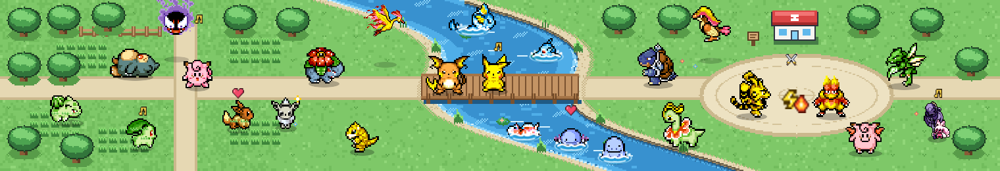

# Herdr Pokémon Party

**[Herdr](https://herdr.dev)를 위한 GBA / NDS 픽셀 아트 포켓몬 생태원 · 배틀 시스템 · 테마 패키지**

[](https://herdr.dev)
[](#경량-설계-및-성능)
[](#1-포켓몬-배틀-시스템)
[](README.md)

<p>
  <a href="README.md">English</a> &nbsp;|&nbsp; <a href="README_zh.md">简体中文</a> &nbsp;|&nbsp; <a href="README_ja.md">日本語</a> &nbsp;|&nbsp; <b>한국어</b>
</p>

</div>

---

## 핵심 시스템

### 1. 포켓몬 배틀 시스템

<div align="center">
  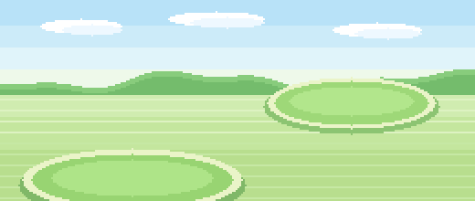
</div>

- **드래그로 즉시 배틀**: 생태원의 포켓몬을 길게 눌러 다른 포켓몬 위에 올려놓으면 아케이드 스타일 VS 컷인과 함께 생태원 내부에서 바로 **GBA 3/4 대각선 배틀**이 펼쳐집니다(상단 터미널 작업을 가리지 않음).
- **정통 GBA 시점 및 조작**: 5세대 정면/후면 애니메이션 스프라이트, 클래식 HP 플레이트, `2×2` 기술 패널을 갖추고 있으며 **키보드(`↑↓←→` / `WASD` / `1–4` / `Enter` / `ESC`)와 마우스**를 모두 지원합니다.
- **고정 4기술 세트**: 각 포켓몬은 생성 시 타입에 맞는 4개 기술(시그니처 기술 포함)을 무작위로 고정 보유하며 파트너를 변경할 때 새로 배정됩니다.
- **실제 토큰 기반 전투력 보정**: 배틀 시작 시 **Claude Code (`cc`) / Codex / Pi / Antigravity (`agy`)** 세션의 실제 토큰 사용량을 온디맨드로 읽어 `×1.00–×2.25` 대미지 배율로 반영합니다(~25ms 소요, 백그라운드 폴링 없음).
- **기술별 픽셀 아트 애니메이션**: 13종의 전용 GBA 픽셀 아트 기술 이펙트 GIF(배경 암전 · 피격 점멸 · 화면 흔들림 포함):

<div align="center">
  
  
  
  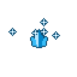
  
  
  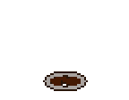
  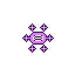
  
</div>

---

### 2. 살아 움직이는 2D 생태원

- **7종의 2D 픽셀 아트 생태 맵** (전경 나무·다리·갈대 깊이 레이어 및 자동 순환 지원):

| 맵 | 미리보기 | 지형 특징 |
| :--- | :---: | :--- |
| **태초마을 강변 (Pallet River)** | 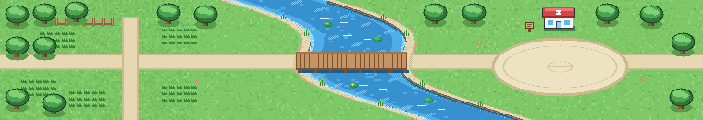 | 굽이치는 강, 나무 다리, 들꽃 광장 |
| **블루시티 해만 (Cerulean Bay)** | 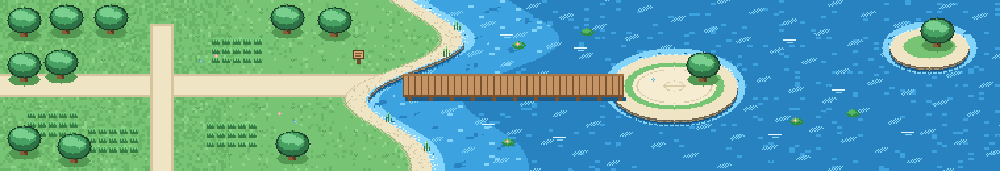 | 군도 해안, 긴 목재 부두, 모래섬 |
| **인주시티 신사 (Ecruteak Shrine)** | 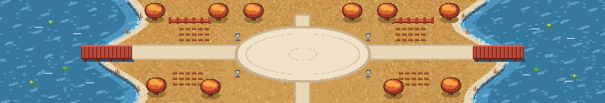 | 단풍숲, 쌍둥이 연못, 붉은 다리 |
| **달맞이산 호수 (Mt. Moon Caldera)** | 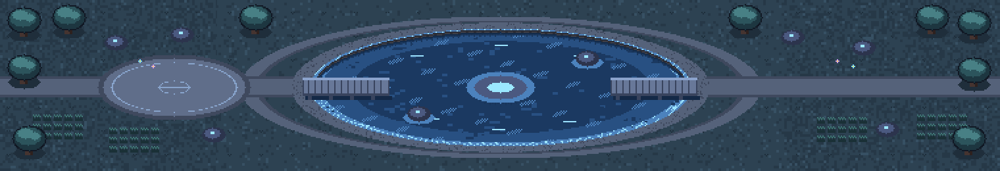 | 별빛 칼데라 호수, 달의돌과 수정 |
| **홍련 환초 (Cinnabar Atoll)** | 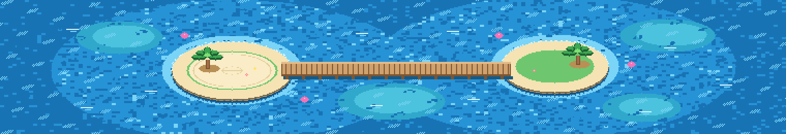 | 열대 산호 환초와 해상 연결 다리 |
| **사막 오아시스 (Sandstone Oasis)** | 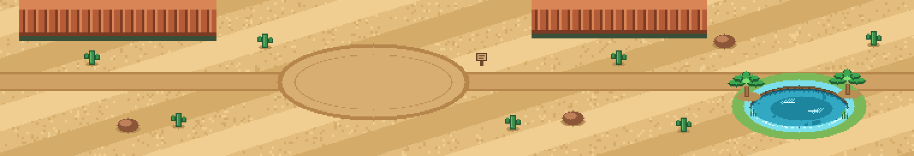 | 모래 언덕, 야자수, 오아시스 샘 |
| **굴뚝산 폭포 (Chimney Waterfall)** | 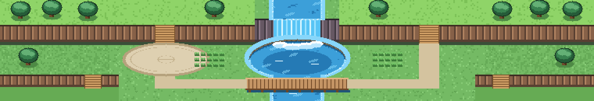 | 흐르는 폭포, 물안개와 협곡 지형 |

- **종족별 지형 AI**: 물 포켓몬은 물속에 몸을 반쯤 담그고 물결을 일으키며 수영하고, 비행 포켓몬은 숲 위를 날다가 육지에 내려와 쉬며, 땅/바위 포켓몬은 땅속을 파고 이동하고, 육지 포켓몬은 다리를 따라 경로를 탐색합니다.
- **자율 교감 & 드래그 인터랙션**: 포켓몬을 직접 집어 원하는 곳에 내려놓을 수 있으며, 포켓몬끼리 스스로 대련·술래잡기·달리기·모임·작업 완료 축하를 하고 **`0.65×` 서브에이전트 미니 팔로워**를 이끌고 다닙니다.
- **작업 공간 우선 레이아웃 & 원클릭 숨김**: 상단 터미널은 전체 화면으로 확보하고, 생태원은 우측 하단 **마스터볼**로 원클릭 수납 및 재소환할 수 있습니다.

---

### 3. 날씨 & 주야간 시스템

- **8종 네이티브 GPU 날씨 효과**: 맑음(햇살 입자), 산들바람(낙엽), 꽃잎, 가랑비, 여우비 무지개, 반딧불이, 소나기, 눈.
- **동적 시간대 조명**: 시스템 시간에 맞춰 낮 / 노을 / 밤 자동 전환(수동 고정 가능).
- **자동 순환 설정**: 설정 팝업에서 맵과 날씨의 자동 전환 주기를 자유롭게 조정할 수 있습니다.

---

### 4. 랜덤 개체 생성 · 이로치 & 성장 진화 시스템

- **생성 시 결정되는 3가지 랜덤 개체 특성**: 새 에이전트를 만들거나 파트너를 교체할 때마다 고유한 개체가 생성됩니다:
  - **희귀 이로치 확률 (`1/64`)**: 수동 스위치 없이 약 1.56% 확률로 **이로치 ✨**가 자연 등장하며 축하 알림이 표시되고 진화 후에도 유지됩니다.
  - **랜덤 개체 크기 (`XS / S / M / L / XL`)**: 생성 시 고유한 체격 크기가 무작위로 배정되어 같은 포켓몬이라도 크고 작은 개성이 드러납니다.
  - **랜덤 고정 4기술 세트**: 생성 시 속성별 기술 풀(시그니처 기술 포함)에서 4개의 배틀 기술을 무작위로 추첨해 고정하며, 파트너를 교체할 때 새로 배정됩니다.
- **작업 경험치 레벨업 & 진화**: 코딩 작업으로 경험치를 쌓아 레벨업(`LV`) 및 자동 진화하며, **진화 잠금(변함없는돌)**으로 원하는 모습을 유지할 수 있습니다.
- **깔끔한 네임플레이트 & 1–9세대 도감**: 하단에는 프로젝트명만 표시하고 마우스 오버 시 `[ LV | 포켓몬 이름 ]` RPG 플레이트를 표시합니다. 이름·번호 빠른 검색 지원.

---

### 5. 울음소리 · 몬스터볼 스페이스 · 다국어 UI

<div align="center">
  
  
  
  
  
  
  
  
  
  
</div>

- **듀얼 소프트 울음소리 엔진**: `Let's Go` / `Showdown` 울음소리를 `ffmpeg`로 부드럽게 필터링하여 에이전트 대기/완료 알림에 활용합니다.
- **10종 픽셀 몬스터볼 스페이스**: 사이드바 스페이스를 우클릭하여 전용 몬스터볼을 지정할 수 있습니다.
- **4개 언어 전환 & 풀 테마 지원**: 생태원 설정에서 한국어 / 영어 / 중국어 / 일본어 전환, 라이트·나이트 테마, GBA 픽셀 / 소프트 UI 전환 지원.

---

## 경량 설계 및 성능

- **전체 저장소 ~1.5 MB**: 7개 맵, 15종 픽셀 애니메이션 GIF, 10종 몬스터볼, 전체 UI 에셋 포함.
- **철저한 온디맨드 캐싱**: 현재 활성 에이전트의 스프라이트·초상화·아이콘·울음소리만 로컬에 캐싱.
- **유휴 리소스 제로 & 기본 절전 모드**: 기본 **Eco(절전) 모드**로 동작하며(상시 환경 GPU 루프 제거, 숨김·비활성 시 자동 절전, 설정에서 풀 이펙트 전환 가능), 생태원 숨김 시 렌더링 부하 제로, 배틀 중 오버월드 일시 정지, 토큰 측정은 배틀 시작 시에만 실행.

---

## 빠른 시작

### 사전 요구 사항
- [Herdr](https://herdr.dev)
- 4방향 스프라이트 생성 및 울음소리 필터링을 위해 권장:
  ```bash
  brew install imagemagick ffmpeg
  ```

### 설치 및 적용

```bash
git clone https://github.com/anson-no-bug/herdr-pokemon-party.git
cd herdr-pokemon-party
chmod +x install.sh
./install.sh

herdr-app check ~/.config/herdr-app/mods/herdr-pokemon
herdr-app do layout.switch '{"name":"herdr-pokemon"}'
herdr-app do app.theme '{"name":"herdr-pokemon-night"}' # 라이트 테마는 "herdr-pokemon"
```

### 주요 단축키 및 조작

| 조작 | 설명 |
| :--- | :--- |
| **포켓몬 / 사이드바 파티 우클릭** | 1–9세대 도감 피커, 진화 잠금, 울음소리 변경 |
| **포켓몬 길게 드래그 → 다른 포켓몬에 드롭** | GBA 포켓몬 배틀 시작 |
| **배틀 중 `↑↓←→` / `WASD` / `1–4` / `Enter` / `ESC`** | 키보드 기술 선택 · 공격 · 종료 |
| **생태원 `×` / 우측 하단 마스터볼** | 생태원 숨기기 / 다시 열기 |
| **생태원 좌상단 톱니바퀴 설정** | 4개 언어 · UI 스타일 · 맵 · 날씨 · 시간대 전환 |
| **사이드바 스페이스 우클릭** | 10종 픽셀 몬스터볼 선택 |

---

## 크레딧 및 감사의 글

이 프로젝트는 아래 훌륭한 오픈소스 프로젝트와 커뮤니티 리소스에 영감을 받아 제작되었습니다:

- **[Herdr](https://herdr.dev)** — 멀티 에이전트 터미널 워크스페이스와 GPUI Mod/Layout 아키텍처, 그리고 커뮤니티 초기 포켓몬 모드(`pokemon-agents` / `pokemon-herd`).
- **[PMDCollab / SpriteCollab](https://github.com/PMDCollab/SpriteCollab)** — 포켓몬 불가사의 던전 4방향 애니메이션 스프라이트 및 표정 초상화(온디맨드 로드).
- **[PokeAPI / Sprites](https://github.com/PokeAPI/sprites)** & **[PokeAPI / Cries](https://github.com/PokeAPI/cries)** — 5세대 정면/후면 배틀 애니메이션, 메뉴 아이콘, 포켓몬 울음소리.
- **[Pokémon Showdown](https://play.pokemonshowdown.com)** — 클래식 배틀 울음소리 오디오.

> **면책 조항**: 본 프로젝트는 비상업적 팬메이드 오픈소스입니다. 포켓몬 및 관련 모든 저작권과 상표권은 Nintendo / Creatures Inc. / GAME FREAK inc.에 있습니다.
