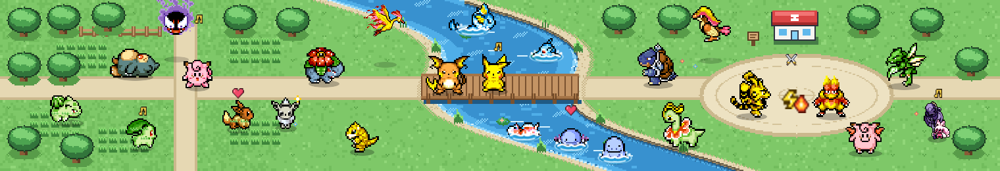
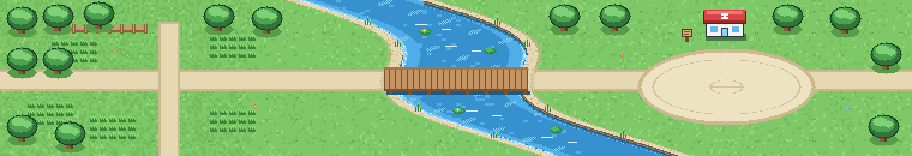
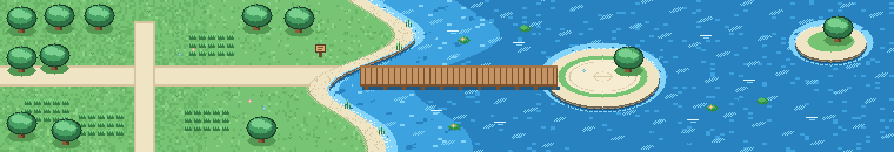
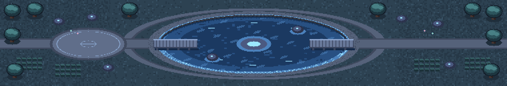
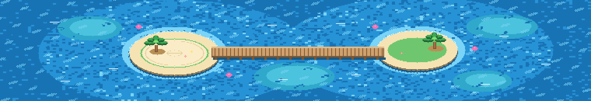
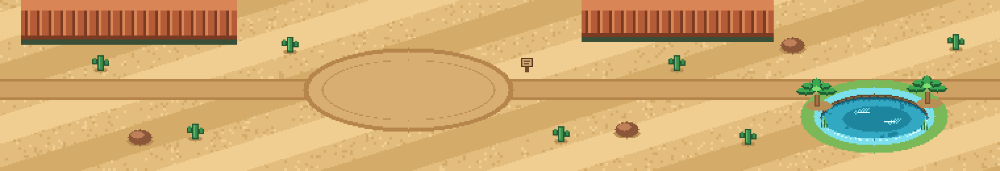
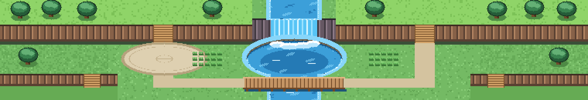

<div align="center">



# Herdr Pokémon Party

**为 [Herdr](https://herdr.dev) 打造的经典 GBA / NDS 像素风宝可梦生态园、对战系统与全套工作台主题**

[](https://herdr.dev)
[](#轻量化与性能承诺)
[](#1-宝可梦对战系统)
[](README.md)

<p>
  <a href="README.md">English</a> &nbsp;|&nbsp; <b>简体中文</b>
</p>

</div>

---

## 核心系统

### 1. 宝可梦对战系统

<div align="center">
  
</div>

- **拖拽即开战**：长按拖动生态园中的任意宝可梦放到另一只身上，触发 KOF 街机风 VS 过场，在生态园原位展开 **GBA 经典 3/4 斜向对战**，完全不遮挡上方终端工作区。
- **地道 GBA 视角与操作**：采用第五世代正反面动态像素精灵、经典奶白血条铭牌与 `2×2` 招式面板，支持**全键盘（`↑↓←→` / `WASD` / `1–4` / `Enter` / `ESC`）与鼠标**双操作。
- **固定专属 4 招**：每只宝可梦生成时随机固定 4 个贴合属性的招式（含招牌技），仅在更换搭档时重新生成。
- **真实 Token 战力加成**：开战瞬间按需读取 **Claude Code (`cc`) / Codex / Pi / Antigravity (`agy`)** 当前会话真实 Token 消耗，动态换算 `×1.00 ～ ×2.25` 伤害倍率（仅耗时 ~25ms，零后台轮询）。
- **招式维度像素动画**：内置 13 套 GBA 像素逐帧招式动画，配合舞台压暗、受击闪烁与震屏：

<div align="center">
  
  
  
  
  
  
  
  
  
</div>

---

### 2. 宝可梦 2D 生态园

- **7 大自绘 2D 像素生态地貌**（带前景树冠 / 桥栏 / 芦苇立体遮挡层，支持自动轮换与手动切换）：

| 生态地图 | 场景预览 | 地形特色 |
| :--- | :---: | :--- |
| **真新镇曲流原野** |  | 曲流河谷、跨河木桥与野花草地 |
| **华蓝群岛海湾** |  | 碧蓝海湾、长木栈道与沙滩孤岛 |
| **缘朱双池神社** |  | 秋林红叶、锦鲤双池与朱红长桥 |
| **月见山环形湖** |  | 星夜火山口、月之石环湖与水晶丛 |
| **红莲珊瑚深海** |  | 热带珊瑚环礁与双岛跨海桥 |
| **沙砾荒漠绿洲** |  | 金黄沙丘、棕榈林与碧绿泉眼 |
| **烟囱山瀑布峡谷** |  | 动态瀑布、飞溅水雾与峡谷岩台 |

- **真实物种地形 AI**：水系宝可梦入水半身潜泳并泛起水花涟漪；飞行系掠过树冠并在陆地收翅栖息；地面/岩石系可潜入土中钻行；陆地宝可梦自动绕行木桥，绝不横穿水面。
- **自主社交互动与自由拖拽**：可随时长按拎起宝可梦放到地图任意位置；宝可梦之间会自发随地切磋、追逐嬉戏、竞速赛跑、广场聚会、任务完成欢呼庆祝，并带领 **`0.65×` 迷你子代理跟班**列队同行。
- **工作区优先 · 一键收放**：上方终端全屏铺满，下方生态园采用黄金比例圆角容器包裹；随时可一键收入右下角常驻大师球让工作区 100% 全屏，再次点击即可重新放出。

---

### 3. 动态天气与昼夜系统

- **8 种原生 GPU 动态天气**：晴朗微尘、微风落叶、花瓣飘落、细雨、雨后彩虹、萤火虫、阵雨、飘雪。
- **昼夜光影变化**：支持随系统时间自动切换白天 / 黄昏 / 夜晚氛围，也可在设置中手动锁定。
- **自定义轮换频率**：可在生态园设置弹窗中自由配置地图与天气自动切换间隔。

---

### 4. 稀有闪光与成长进化系统

- **纯概率自然出闪（`1/64`）**：无手动闪光开关，每次新建智能体或切换新宝可梦时以 **`1/64`（≈ 1.56%）** 概率自然触发稀有**闪光 ✨** 个体，命中时弹出专属惊喜通知，且进化后永久保留闪光身份。
- **工作经验升级与自动进化**：智能体持续编码会积累经验提升等级（`LV`）并自动无缝进化；图鉴内提供「**锁定进化**（不变之石）」开关，自由保留心仪形态。
- **个体体型与悬浮铭牌**：每只宝可梦拥有独立 `XS–XL` 体型差异；脚下仅保留简洁项目名，鼠标悬停时头顶展示精致两段式 `[ LV | 名称 ]` RPG 铭牌。
- **Gen 1–9 全图鉴选择器**：支持中英文名称及图鉴编号秒搜，图标严格按需缓存。

---

### 5. 原声叫声、精灵球空间与双语界面

<div align="center">
  
  
  
  
  
  
  
  
  
  
</div>

- **双原声叫声引擎**：支持 `Let's Go` 与 `Showdown` 两套宝可梦叫声，经 `ffmpeg` 柔和滤波处理，用于智能体等待处理 / 任务完成提示，悦耳不刺耳。
- **10 种像素精灵球空间**：右键侧边栏任意空间即可切换专属精灵球图标。
- **纯中文 / 纯英文全局切换**：设置中一键切换全局语言，内置 260 只宝可梦官方中文译名与完整招式译名。
- **全套主题覆盖**：日间 / 月见山暗夜双主题，清爽模式 / 经典 GBA 像素风格一键切换（`Alt+Shift+G`），覆盖文件树图标、Git 变更、右键菜单、弹窗与通知横幅。

---

## 轻量化与性能承诺

- **仓库极简（~1.5 MB）**：包含全部 7 张 2D 生态图、15 套像素动画 GIF、10 种精灵球与全套 UI 代码素材。
- **严格按需缓存**：精灵动画、头像立绘、图鉴图标与叫声音频仅对当前活跃智能体按需下载并缓存至本地。
- **零后台浪费**：生态园隐藏后零渲染开销；对战时自动暂停大地图巡逻；Token 消耗仅在开战瞬间按需读取。

---

## 快速安装

### 环境依赖
- 已安装 [Herdr](https://herdr.dev)
- 建议安装 `ImageMagick`（4 向动态像素精灵切割）与 `ffmpeg`（叫声柔和滤波）：
  ```bash
  brew install imagemagick ffmpeg
  ```

### 安装与启用

```bash
git clone https://github.com/anson-no-bug/herdr-pokemon-party.git
cd herdr-pokemon-party
chmod +x install.sh
./install.sh

herdr-app check ~/.config/herdr-app/mods/herdr-pokemon
herdr-app do layout.switch '{"name":"herdr-pokemon"}'
```

### 常用操作

| 操作 | 说明 |
| :--- | :--- |
| **右键点击宝可梦 / 侧边栏队员** | 打开 Gen 1–9 图鉴更换搭档、设置「锁定进化」或切换叫声引擎 |
| **长按拖动宝可梦 → 放到另一只身上** | 触发 VS 过场并原地开启 GBA 宝可梦对战 |
| **对战中 `↑↓←→` / `WASD` / `1–4` / `Enter` / `ESC`** | 全键盘选招、出招、退出对战 |
| **点击生态园 `×` / 右下角大师球** | 一键收入隐藏 / 重新放出生态园 |
| **`Alt + Shift + P`** | 快速为当前聚焦智能体打开宝可梦图鉴 |
| **`Alt + Shift + G`** | 一键切换清爽模式 / 经典 GBA 像素风格 |
| **右键侧边栏空间** | 自由更换 10 种像素精灵球外观 |

---

## 致敬与资源鸣谢

本项目基于并致敬以下优秀开源项目与社区艺术资源：

- **[Herdr](https://herdr.dev)** — 强大的多智能体终端工作台与开放的 GPUI Mod / Layout 架构，以及社区早期宝可梦插件（`pokemon-agents` / `pokemon-herd`）带来的灵感启发。
- **[PMDCollab / SpriteCollab](https://github.com/PMDCollab/SpriteCollab)** — 精美的《宝可梦不可思议迷宫》四方向动态像素精灵与多表情立绘（按需动态拉取）。
- **[PokeAPI / Sprites](https://github.com/PokeAPI/sprites)** & **[PokeAPI / Cries](https://github.com/PokeAPI/cries)** — 第五世代正反面动态对战精灵、图鉴菜单图标与最新宝可梦叫声。
- **[Pokémon Showdown](https://play.pokemonshowdown.com)** — 经典宝可梦对战叫声音效。

> **免责声明**：本项目为非商业开源爱好者作品。Pokémon（宝可梦）及相关角色名称、图像与音效版权均归 Nintendo / Creatures Inc. / GAME FREAK inc. 所有。
