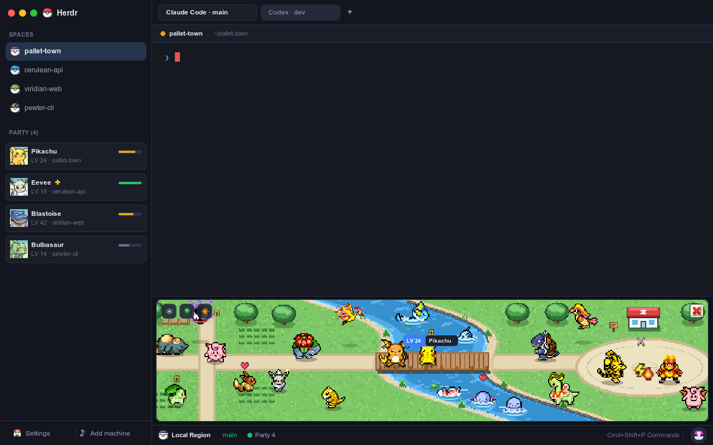

# Herdr Pokémon Party

A workspace-first GBA/NDS Pokémon RPG overhaul layout for Herdr. Keeps the main terminal edge-to-edge on top, replaces spaces with 10 pixel-art Poké Balls, turns every coding agent into a roaming pixel-art Pokémon in a 7-biome 2D living habitat below (with species-aware swimming/flying/burrowing AI, dynamic weather, natural `1/64` Shiny odds, random sizes, fixed 4-move sets, Work-XP evolution, and drag-onto-Pokémon inline GBA battles scaled by real session token usage), and recalls cleanly into a persistent bottom-right Master Ball dock whenever you want 100% full-screen focus.

## What you see

- **Left sidebar (`272px`, chrome `#f6f7f9` / night `#13161e`)**:
  - Top **Brand** block (`46px`, window-draggable): Poké Ball crest, title, quick-open search button, and sidebar collapse toggle (`44px` / `76px` on macOS).
  - **Spaces** list (flex weight 1): each space wears one of 10 pixel-art Poké Balls (open ball when active), plus branch badge and quick actions.
  - **Party / Agents** list (flex weight 1): each running agent displays its PMDCollab portrait, level, name, Shiny sparkle if rolled, and status-colored mini HP bar (`working` amber, `blocked` red, `done` green, `idle` slate).
  - **Sidebar Footer** (`44px`): Settings and Add Machine buttons.
- **Right column (`work`, non-resizable)**:
  - **Tabs** bar (`44px`, window-draggable): party tabs with Pokémon menu icons, `+ New` summon popup, Bag (Files) and VS Log (Changes) right-panel toggles.
  - **Main Work Body** (flex 1, `padding: 0`, `gap: 1`): full-bleed edge-to-edge terminal pane (`radius: 0`, `lone: false`) with a `32px` trainer-plate pane header, plus a collapsible right `panel` (`368px`) hosting Files (with 24 custom file-type icons) and Changes (git diff & commit).
  - **Pokémon Habitat** (`232px` outer dock / `220px` inner rounded card with 4 concave SVG corner masks): 7 hand-crafted 2x pixel-art 2D maps with foreground depth occlusion (`*_fg.png`), animated water sparkles & waterfalls, 8 GPU weather particle modes, day/dusk/night veil, top-left Gear / Map / Weather icon buttons, and a top-right GBA pixel `×` recall button.
  - **Status Bar** (`36px`): active space Poké Ball, region/machine name, git branch, party count + waiting badge, command palette hint, and a persistent bottom-right pixel **Master Ball** dock.

## How it behaves

- **Agent statuses**:
  - `working`: Pokémon actively patrols terrain-valid paths (swimmers submerge & bob in lakes/rivers, flyers soar over canopies, burrowers tunnel underground, land species cross bridges), accumulating Work-XP (`+1.2 XP/s`, `+28 XP` on turn completion) to level up and auto-evolve unless **Lock Evo** is enabled.
  - `idle`: Pokémon strolls slowly, perches or naps (`zZz` after 3 minutes idle).
  - `blocked`: stops and displays a pulsing red `!` badge and plays a softened Pokémon cry.
  - `done`: hops with a green `✓` / `★` celebration and nearby Pokémon gather to cheer with a gentle chirp.
  - **Subagents**: spawn as `0.65×` base-form mini-followers trailing behind their parent Pokémon; clicking peeks the subagent terminal.
- **Per-Pokémon random generation traits**: every new agent or newly selected species independently rolls a `1/64` natural Shiny ✨ encounter (no manual toggle, triggers toast on hit, kept on evolution), an individual `XS–XL` body scale, and 4 fixed species-fitting battle moves (re-rolled only when changing species).
- **Pointer, drag & keyboard interactions**:
  - **Hover Pokémon**: clean project tag stays underfoot while a split `[ LV xx | Name ]` RPG nameplate pops above the head.
  - **Click Pokémon**: focuses its agent pane.
  - **Right-click Pokémon / Party row**: opens the Gen 1–9 Pokédex Picker (search by EN/ZH name or `#number`, toggle Lock Evo, switch `Let's Go` / `Showdown` cry set).
  - **Hold & drag Pokémon**: lifts it dangling with a struggling animation; drop over water/land for terrain reactions, or drop onto another Pokémon (showing a KOF VS lock-on badge) to launch an **inline GBA 3/4 diagonal battle** right inside the habitat card.
  - **Inline GBA Battle**: reads real session tokens on demand from Claude Code (`~/.claude/projects`), Codex (`~/.codex/sessions`), Pi (`~/.pi/agent/sessions`), or Antigravity (`~/.gemini/antigravity`) for `×1.00–×2.25` damage scaling; plays 13 bespoke GBA pixel-art animated move FX GIFs with backdrop dimming, 3-blink hit flicker, and shake; controlled by mouse or full keyboard (`↑↓←→` / `WASD` / `1–4` / `Enter` / `Space` / `ESC`).
  - **Recall & Release**: clicking the habitat's top-right pixel `×` (or bottom-right Master Ball) sucks each Pokémon one-by-one and scales the map canvas into the Master Ball (`b-recall.gif`), hiding `pokemon-habitat` for 100% terminal height; clicking the bottom-right Master Ball unfolds the canvas and pops every Pokémon back out (`b-release.gif`).
  - **Keybindings** (`layout:herdr-pokemon`): `cmd-w` (RPG close confirm), `f2` (rename tab), `shift-f2` (rename space).

## Built from

- **Layout**: `layouts/herdr-pokemon.json` (`root` row -> `sidebar` column [`brand`, `sidebar-lists` (`spaces`, `agents`), `sidebar-footer`] + `work` column [`tabs`, `work-body` (`main`, hidden `panel` stack [`files`, `changes`]), `pokemon-habitat`, `status`]).
- **Themes**: `themes/herdr-pokemon.json` (light) and `themes/herdr-pokemon-night.json` (dark).
- **Single multi-role mod**: `mods/herdr-pokemon/` dispatched by `props().role` in `main.js`:
  - `brand`, `spaces`, `agents`, `footer`, `tabs`, `pane`, `habitat`, `status`, `files`, `changes`, `menu`, `new-menu`, `dialog`, `toast`, `picker` (plus inline `EmbeddedBattle` inside `battle.js` and `InteractionEngine2D` in `interactions.js`).
  - Also registered as layout `toast`, `terminal_menu`, and `link_handlers`.
- **Herdr APIs & commands**: `agents`, `terminals`, `spaces`, `panes`, `theme`, `settings`, `shared`, `setShared`, `layout`, `openOverlay`, `closeOverlay`, `nextCommand`, `playSound`, `notify`, `exec`, `fs`, `run` (`pane.focus`, `agent.focus`, `terminal.peek`, `layout.show`, `layout.hide`, `layout.resize`, `layout.select`, `tab.*`, `space.*`, `app.palette`, `app.settings`).
- **External programs & network (on-demand only)**:
  - `curl` fetches active Pokémon sprites/portraits from `PMDCollab/SpriteCollab`, Gen 5 animated battle sprites & icons/cries from `PokeAPI/sprites` & `PokeAPI/cries`, and classic cries from `play.pokemonshowdown.com`, cached under `~/.config/herdr-app/data/pokemon-agents/`.
  - `magick` / `convert` (ImageMagick) slices 4-direction animated GIFs (with 2px transparent padding & frame-0 anchor bbox); `ffmpeg` applies gentle loudness/bandpass filtering to cries.
  - Reads tail bytes of local agent session logs strictly on battle open for token-scaled damage.
- **Bundled art**: 7× 2D biome PNGs + 7× foreground PNGs + GBA `battle-bg.png`, 15× animated pixel-art battle/Master Ball GIFs, 10× closed/open Poké Ball SVGs, 24× file-type SVGs, and pixel UI icons (`~1.5 MB` total).

## Watch out

- `gpui-kit` `.transition(property, policy)` only accepts `"opacity"`, `"width"`, `"height"`, `"left"`, or `"top"` (never `"w"` or `"h"`).
- `gpui-kit` `overflow_hidden()` clips child `image()` elements rectangularly; `habitat.js` stamps 4 concave `10×10` corner-mask SVGs tinted to `p.canvas` on top of the rounded card so map corners never bleed.
- `mouse` event `position` / `local_position` are in window px and must be divided by `settings().zoom`.
- `ImageMagick` (`magick`/`convert`) and `ffmpeg` are optional but strongly recommended for full 4-direction animated sprites and softened cries (falls back gracefully to menu icons / raw audio if absent).
- Layout height for `pokemon-habitat` is fixed at `232px` (`220px` inner card) so sprites, nameplates, and the inline GBA battle stage never clip.

## Done when

- `herdr-app check ~/.config/herdr-app/mods/herdr-pokemon` exits 0 with `check passed`.
- `herdr-app do layout.switch '{"name":"herdr-pokemon"}'` renders full-bleed top terminal, left Poké Ball spaces + Party portraits, rounded bottom Pokémon Habitat card with zero square corner bleed, and bottom-right persistent Master Ball dock.
- Dragging one Pokémon onto another opens the inline GBA battle with animated pixel FX, keyboard move selection (`WASD`/`Enter`/`1–4`/`ESC`), and token-scaled damage.
- Clicking the habitat's top-right pixel `×` recalls Pokémon and collapses the habitat into the bottom-right Master Ball (`layout.hide`), and clicking the Master Ball releases them back out (`layout.show`).
- Right-clicking any Pokémon opens the Pokédex Picker with working `Lock Evo`, 4-language switching (`EN`/`ZH`/`JA`/`KO` in habitat settings), and natural `1/64` Shiny rolls without a manual shiny toggle.
